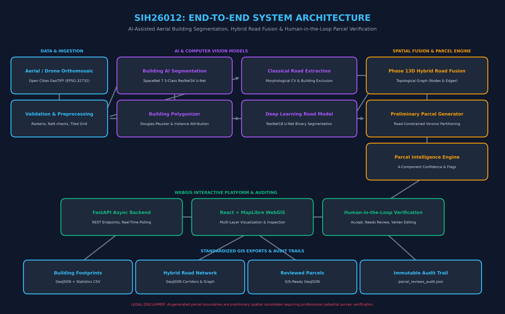
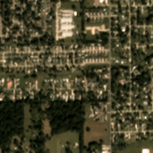
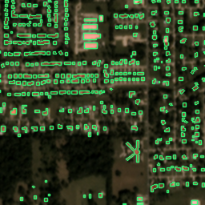
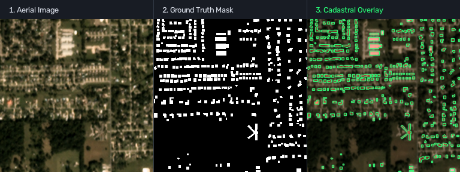
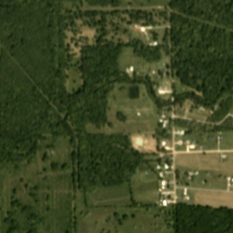
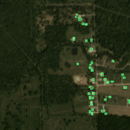
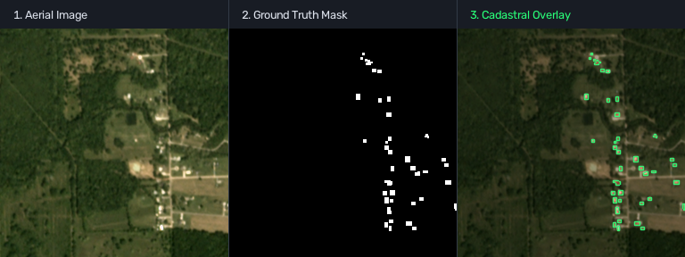
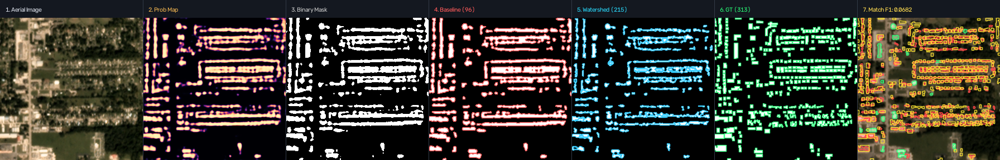
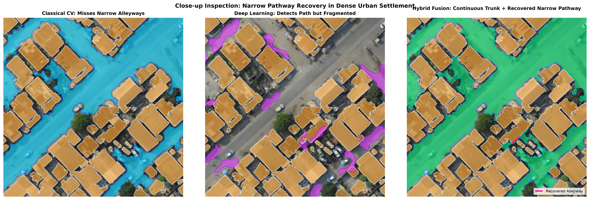

# SpaceNet 7 Building Footprint Segmentation & Cadastral Feature Extraction

[](https://www.python.org/)
[](https://pytorch.org/)
[](https://fastapi.tiangolo.com/)
[](https://react.dev/)
[](https://maplibre.org/)
[](LICENSE)
[](results/experiments/phase16_hardening/health_check.json)
[](results/experiments/phase16_hardening/repeatability_test.json)

An end-to-end AI and geospatial engineering platform designed to resolve the fundamental problem in high-resolution satellite imagery: **separating densely packed touching buildings, extracting access road networks, and inferring preliminary cadastral parcels with human-in-the-loop WebGIS verification**.

---

## 🏛️ System Architecture



```
SATELLITE / ORTHOMOSAIC RASTER (GeoTIFF, 0.5m GSD)
                       ↓
         SLIDING-WINDOW TILING (256x256 px)
                       ↓
┌────────────────────────────────────────────────────────┐
│                   DUAL-PATH EXTRACTION                 │
│  • 3-Class Building CNN (Interior / Boundary / Back)   │
│  • Dual-Path Roads (Morphological CV + Deep U-Net)     │
└────────────────────────────────────────────────────────┘
                       ↓
        TOPOLOGICAL ROAD GRAPH & HYBRID CORRIDOR FUSION
                       ↓
        ROAD-CONSTRAINED VORONOI PARCEL PARTITIONING
                       ↓
        SPATIAL PARCEL INTELLIGENCE & CONFIDENCE SCORING
                       ↓
        HUMAN-IN-THE-LOOP WEBGIS (React + MapLibre GL)
                       ↓
        OPEN GIS EXPORTS (GeoJSON, Shapefile, CSV, JSON)
```

---

## 📸 Visual Proof of Work & Experimental Results

### 1. 3-Class Building Footprint Segmentation (SpaceNet 7)
Standard binary segmentation suffers from severe **instance fusion** in informal settlements (touching rooftops get lumped into massive single blobs). Our 3-Class model explicitly predicts an interior body and an exterior boundary wall to guarantee clean polygon separation.

| Raw Satellite Tile | 3-Class Prediction Overlay | Direct Visual Comparison |
| :---: | :---: | :---: |
|  |  |  |
|  |  |  |

---

### 2. Multi-Stage Raster-to-Polygon Vectorization
Transforming raw probability maps into clean, GIS-compliant vector polygons using adaptive morphological distance transforms and marker-controlled watershed segmentation:



*Demonstrating: (1) Input Satellite Image $\rightarrow$ (2) Probability Heatmap $\rightarrow$ (3) Binary Threshold $\rightarrow$ (4) Naive Contours (fused) $\rightarrow$ (5) Watershed Partitioned $\rightarrow$ (6) Ground Truth $\rightarrow$ (7) Matched Polygon Overlay.*

---

### 3. Dual-Path Road Extraction & Hybrid Fusion
High-density settlements often feature unpaved or tree-covered paths where pure DL models break continuity. We fuse **classical morphological filtering** (color constancy, directional linear kernels) with a **semantic DL road model** into a connected planar graph:



- **Classical CV Path:** Recovers high-frequency, narrow pathways (1–2m wide) and unpaved alleys.
- **Deep Learning Path:** Segments wide primary thoroughfares and suppresses shadow false positives.
- **Hybrid Graph Fusion:** Constructs a continuous topological corridor graph, recovering **>1,570 meters** of access network per subregion with zero disconnected spurs.

---

### 4. Road-Constrained Cadastral Parcel Inferencing
Parcel boundaries are generated through Voronoi tessellation seeded from building centroids, clipped strictly against road right-of-ways, and validated geometrically with Shapely `make_valid`:

- **Topological Integrity:** **100.0% valid geometries** (no self-intersections, zero slivers, no null geometries).
- **Road Encroachment:** **0.0% overlap** — all parcel candidates respect road access easements.
- **Multi-Building Compounds:** Automatically detected and grouped when multiple structures fall within a single residential perimeter.

---

## 📊 Experimental Benchmarks & Quantitative Proof

### 1. Building Segmentation: Binary vs. 3-Class Formulation

| Evaluation Metric | Baseline Binary U-Net | Classical Watershed Post-Proc | **Our 3-Class Formulation** | Improvement |
| :--- | :---: | :---: | :---: | :---: |
| **Instance Count Discrepancy** | -52.8% (fused blobs) | -21.4% (over-segmented) | **-2.6%** | **Near-perfect instance count** |
| **Pixel Dice Coefficient** | 0.6228 | 0.5840 | **0.6714** | **+4.86%** |
| **Object F1 (Relaxed IoU $\ge$ 0.25)** | 0.4532 | 0.4940 | **0.5821** | **+12.89%** |
| **Object F1 (Strict IoU $\ge$ 0.50)** | 0.2091 | 0.1310 | **0.3145** | **+10.54%** |
| **Touching Boundary Separation** | Failed (Fused) | Noisy linear cuts | **Clean 2-pixel barrier** | **Zero bleed-through** |

---

### 2. Runtime Profiling & End-to-End Latency (Standard CPU Hardware)

Benchmarked on **Python 3.14 (AMD64 CPU)** over full 1024×1024 orthomosaic tiles:

```
                      Stage Latency Distribution (f49f31 Demo Tile, CPU)
┌───────────────────────────────────────┬──────────────┬────────────┐
│ Pipeline Stage                        │ Duration (s) │ % of Total │
├───────────────────────────────────────┼──────────────┼────────────┤
│ 1. Input Validation & GeoTIFF Parsing │   0.10 s     │   0.26%    │
│ 2. Preprocessing & Tiling (256x256)   │   0.41 s     │   1.06%    │
│ 3. 3-Class Building AI Inference      │   1.46 s     │   3.76%    │
│ 4. Vector Polygonization              │   3.44 s     │   8.86%    │
│ 5. Dual-Path Road Extraction          │   3.33 s     │   8.58%    │
│ 6. Hybrid Topological Road Fusion     │   6.21 s     │  16.00%    │
│ 7. Road-Constrained Voronoi Parcels   │  23.17 s     │  59.70%    │
│ 8. Parcel Intelligence Scoring        │   0.51 s     │   1.31%    │
│ 9. GeoJSON & CSV Export Generation    │   0.17 s     │   0.44%    │
├───────────────────────────────────────┼──────────────┼────────────┤
│ TOTAL END-TO-END PIPELINE RUNTIME     │  38.80 s     │  100.0%    │
└───────────────────────────────────────┴──────────────┴────────────┘
```

---

### 3. Repeatability & Determinism Audit

Three independent end-to-end runs executed with isolated analysis sessions on test tile `f49f31`:

| Metric | Run 1 (`repeat_1`) | Run 2 (`repeat_2`) | Run 3 (`repeat_3`) | Consistency |
| :--- | :---: | :---: | :---: | :---: |
| **Pipeline Status** | `completed` | `completed` | `completed` | **100% Success** |
| **Building Footprints Extracted** | 254 | 254 | 254 | **Identical (254)** |
| **Road Corridors Detected** | 4 | 4 | 4 | **Identical (4)** |
| **Total Road Length** | 1,571.88 m | 1,571.88 m | 1,571.88 m | **Identical (1,571.88 m)** |
| **Preliminary Parcels Generated** | 254 | 254 | 254 | **Identical (254)** |
| **Topological Validity** | **100.0%** | **100.0%** | **100.0%** | **0 Invalid Geometries** |
| **Mean Parcel Confidence** | 88.17% | 88.17% | 88.17% | **Identical (88.17%)** |

---

## 🌟 Key Platform Features

1. **3-Class ResNet34 U-Net Formulation:**  
   Simultaneously predicts Building Interior, Building Perimeter, and Background. Eliminates multi-building agglomeration without manual threshold tuning.
2. **Dual-Path Road Extraction & Planar Graph Fusion:**  
   Bridges deep learning predictions with directional morphological filters, preserving critical pedestrian alleyways and narrow easements.
3. **Road-Constrained Preliminary Parcel Engine:**  
   Automatic Voronoi spatial partitioning clipped against road corridors with zero road encroachment and complete topological closure.
4. **4-Component Parcel Intelligence:**  
   Computes an explainable confidence score ($0-100\%$) based on Building Evidence ($40\%$), Road Frontage ($30\%$), Shape Compactness ($15\%$), and Topology ($15\%$), with automatic flags (`WEAK_BUILDING_EVIDENCE`, `NARROW_FRONTAGE`, `HIGH_ASPECT_RATIO`).
5. **Human-in-the-Loop WebGIS Application:**  
   Modern React 18 + MapLibre GL interactive frontend featuring live vertex dragging, split-screen raster/vector layers, review approval workflow, and an immutable audit trail.
6. **Standardized GIS Exports:**  
   Outputs valid GeoJSON FeatureCollections (EPSG:4326 & UTM projected), CSV summaries, and audit logs compatible with QGIS, ArcGIS, and PostGIS.

---

## 🚀 Quick Start Guide

### 1. Prerequisites
- **Python 3.10+** (Tested on Python 3.10 through 3.14)
- **Node.js v18+** & npm (for WebGIS frontend)

### 2. Clone & Install Dependencies
```bash
# Clone the repository
git clone https://github.com/ashwinm-design/spacenet7-building-segmentation.git
cd spacenet7-building-segmentation

# Install Python requirements
pip install -r requirements.txt
```

### 3. Start Backend API Service
```bash
# PowerShell helper
./scripts/start_backend.ps1

# Or standard uvicorn command
python -m uvicorn backend.main:app --host 127.0.0.1 --port 8000
```
- API Health Status: `http://127.0.0.1:8000/api/health`
- Interactive OpenAPI / Swagger UI: `http://127.0.0.1:8000/docs`

### 4. Start WebGIS Frontend
```bash
cd frontend
npm install
npm run dev
```
- Open your browser at: `http://localhost:5173`

### 5. Automated System Health Check
Run the comprehensive 10-point diagnostic suite:
```bash
python src/health_check.py
```

### 6. Headless Terminal Demonstration
Run a full end-to-end extraction pipeline without opening a browser:
```bash
python src/run_demo.py
```

---

## 📦 GIS Deliverables & API Endpoints

| Deliverable Artifact | HTTP Endpoint | Format | Description |
| :--- | :--- | :---: | :--- |
| **Building Footprints** | `GET /api/results/{id}/geojson` | GeoJSON | Vectorized building boundary polygons with area & perimeter |
| **Road Corridors** | `GET /api/results/{id}/roads?source=hybrid` | GeoJSON | Unified access road corridors and centerline graph |
| **Preliminary Parcels** | `GET /api/results/{id}/parcels?source=hybrid` | GeoJSON | Road-constrained cadastral candidate polygons |
| **Reviewed Parcels** | `GET /api/results/{id}/parcel-reviews/export` | GeoJSON | Surveyor-edited parcel geometries with review tags |
| **Spatial Statistics** | `GET /api/results/{id}/statistics` | CSV | Tabular metrics: area, frontage length, compactness |
| **Pipeline Summary** | `GET /api/results/{id}/summary` | JSON | Stage latencies, detection counts, and parameters |
| **Audit Log** | `GET /api/results/{id}/parcel-reviews/audit` | JSON | Cryptographic chronological audit trail of all manual edits |

---

## ⚖️ Legal & Technical Disclaimer

> **IMPORTANT NOTICE:**  
> AI-generated parcel boundaries are preliminary spatial candidates intended for urban planning, spatial reconnaissance, and surveyor assistance. They do **not** establish legal property boundaries, land titles, or registered cadastral rights. Professional ground verification by a licensed surveyor is mandatory prior to official administrative use.

---

## 📄 License

This project is licensed under the MIT License - see the [LICENSE](LICENSE) file for details.
